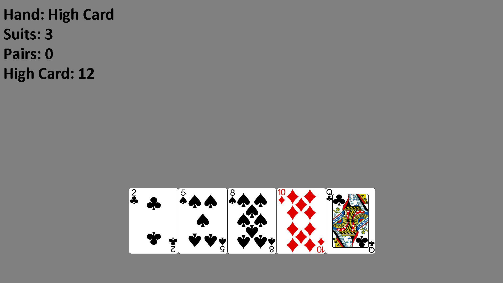

# PokerSimulator
 
A Java poker game that detects the monitors connected to your computer and gives each player their own screen.
 

 
<!-- Add a screenshot at docs/screenshot.png, or delete the line above. -->
 
## Features
 
- Automatically detects connected monitors
- Opens a separate window for each player, one per monitor
- Space key shuffles the deck and then gives every player five cards
- Display winner by pressing enter (requires 2+ players)

## Requirements
- Java 22 or newer

## How to run
 
**Build from source**
 
This is a NetBeans (Ant) project.
 
1. Open NetBeans and choose **File > Open Project**, then select this folder.
2. Click **Run**.

## How it works
 
On startup, the game asks Java's `GraphicsEnvironment` for every connected screen (`getScreenDevices()`) and starts a `GameThread` for each one. Each monitor gets its own `JFrame`, created on that screen's graphics configuration, with a Swing canvas (`DrawCanvas`) tied to that monitor's player.
 
When a canvas draws, it loops over every hand but marks a card as hidden unless the hand belongs to that monitor's player. Other players' cards are drawn face down using the card-back image, so each player only sees their own cards, as at a real table.
 
**Test mode** deals the number of random hands you enter and reports the percentage of each poker hand rank, such as pairs and flushes.
 
